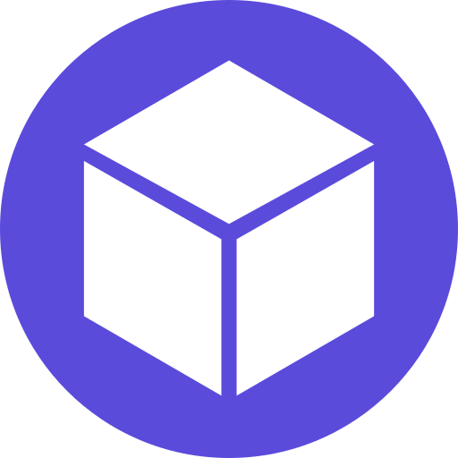
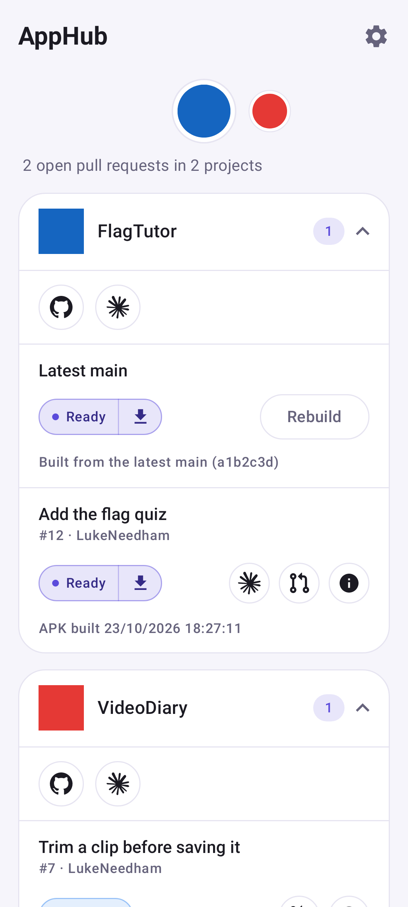
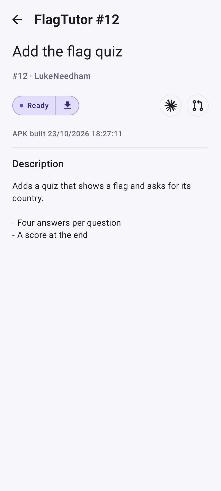
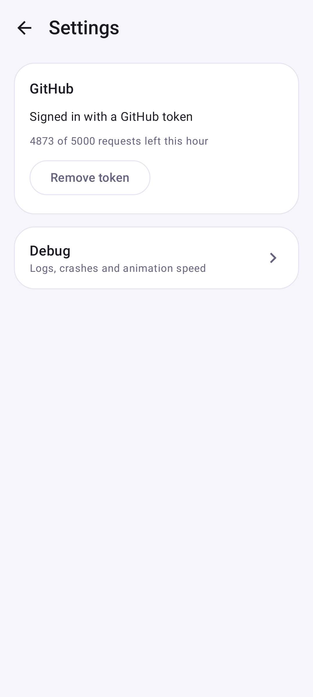

<!-- Generated from readme.yml by LukeNeedham/ci-workflows (docs/readme.md). Edit readme.yml, not this file. -->
<p align="center">
  
</p>

# AppHub

Install and try the pull request builds of my apps straight from my phone.

## Description

AppHub lists the open pull requests of the public repos of `LukeNeedham`, with each PR's debug APK and web test
deploy, so a PR build can be installed and tried on a phone without a computer. It reads the comment that the shared
CI ([ci-workflows](https://github.com/LukeNeedham/ci-workflows)) leaves on every PR.

Use it to install a PR's build in a tap, open its web preview, jump to the PR or its Claude Code session, see
whether the build you have installed is the latest, and build and install the latest `main` of any repo on demand.
Every PR also has a link of its own, `https://www.lukeneedham.com/apphub/pr/<repo name>/<number>`, that opens it
in the app.

## Screenshots





## Getting started as a user

1. Download the debug APK from the comment that CI posts on any pull request of this repo, and install it. The first time, Android asks to allow AppHub to install apps.
2. Optional: add a GitHub personal access token under Settings → GitHub, for a higher rate limit and for building main.

Requires Android 8.0 (API 26) or newer.

## Getting started as a developer

Requirements: JDK 17 and the Android SDK (platform 36), for example through Android Studio.

```
git clone https://github.com/LukeNeedham/AppHub.git
cd AppHub
./gradlew assembleDebug    # the APK is in app/build/outputs/apk/debug/
./gradlew test             # unit tests
```

Every pull request is built by CI, which comments on it with a link to install the APK.

Like all my apps, it follows the shared architecture and conventions (single activity, Jetpack Compose, Navigation 3, MVVM with every page split into a `Page` and a `PageContent`, Koin): see [ci-workflows](https://github.com/LukeNeedham/ci-workflows/blob/main/docs/new-app.md).

In debug builds, Settings (top right) leads to the Debug page.

## Contributing

Branch from `main`, make the change, and open a pull request. CI must be green before it is merged.

## License

All rights reserved.
